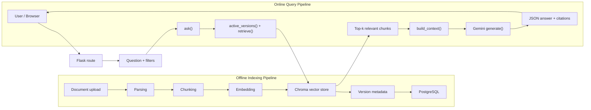
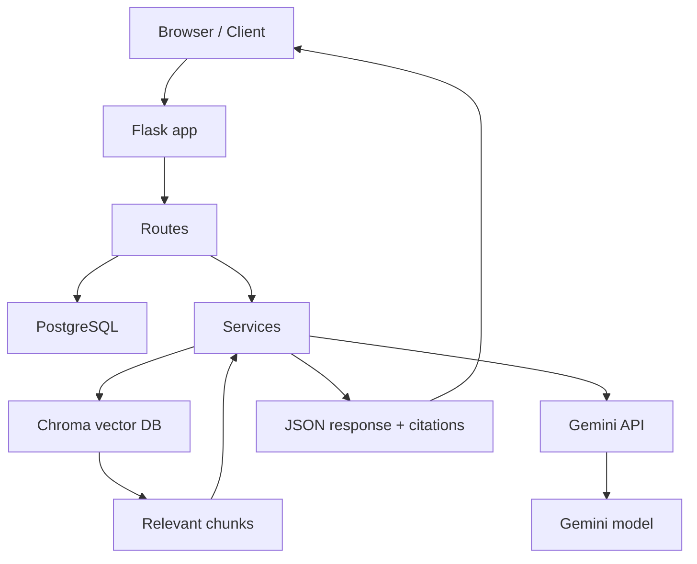

> **2026-10 хэрэгжилтийн шинэчлэл:** Энэ draft-ийг шинэ modular hybrid хувилбарт нийцүүлэн уншина уу. Retrieval одоо active-version dense search болон Unicode-aware version-scoped BM25-г RRF (`k=60`) аргаар нэгтгэнэ; sparse индексийн асуудал dense fallback ба degraded trace үүсгэнэ. Cross-encoder болон conditional rewrite нь opt-in. Query processing Монгол кирилл/латин, English, mixed, unknown ангилалтай; генерац Монгол кирилл шаардаж, citation validation хадгалагдана. Шинэ бодит call graph, lifecycle, тохиргоо, хязгаарлалт нь [08](08-advanced-rag-implementation.md) болон [09](09-multilingual-mongolian-rag.md)-д байна. Доорх анхны baseline тайлбарын хуучирсан хэсгийг шинэ баримтууд орлоно.
# 01. RAG Architecture

## 1. Objective

Энэ баримт нь энэ төсөлд хэрэгжүүлсэн Retrieval-Augmented Generation (RAG) архитектурыг кодын жинхэнэ хэрэгжилтээр тайлбарлах зорилготой. Системийн гол зорилго нь баримт бичгийг хадгалах, текстийг чангаараар задлах, embedding үүсгэх, semantic search хийх, улмаар Gemini API-тай холбогдож grounded answer гаргах явдал юм.

Энэ проект нь "RAG"-ийн үндсэн 2 том шугамтай ажилладаг:

1. Offline / Indexing pipeline - баримт upload, parse, chunk, embed, Chroma индекс үүсгэх
2. Online / Query pipeline - хэрэглэгчийн асуулт, embedding, Chroma query, prompt-ийг бэлдэх, Gemini генераци

Төслийн файлд хэрэглэгдэж буй бодит бүрэлдэхүүн хэсгүүдийг доор нэгтгэн үзүүлнэ.

## 2. High-level RAG architecture

### 2.1 Architecture explanation

- Document upload/review route нь [app/routes/documents.py](../app/routes/documents.py) дахь `/documents` болон `/versions/<version_id>/process`-ээр эхэлнэ.
- Parsing нь [app/services/parsing.py](../app/services/parsing.py) дотор PDF/DOCX/DOC файл доторх текстийг боловсруулна.
- Chunking нь [app/services/chunking.py](../app/services/chunking.py) дотор 1800/250 character window-тай ажиллана.
- Embedding нь [app/services/gemini.py](../app/services/gemini.py) дахь `Gemini.embed()` ашиглан `gemini-embedding-001` моделийг хэрэглэнэ.
- Vector storage нь [app/services/vectorstore.py](../app/services/vectorstore.py) дахь `VectorStore`-ээр Chroma PersistentClient ашиглан хадгална.
- Query pipeline нь [app/services/rag.py](../app/services/rag.py) `ask()` function-аас эхэлж, retrieval, prompt construction, generation-аар дамжина.
- PostgreSQL нь зөвхөн metadata, version lifecycle, query logs, evaluation records, document state-ийг хадгална; Chroma нь текст болон embedding vector-ийг хадгалдаг.

## 3. Actual Flask + PostgreSQL + Chroma + Gemini interaction

## 4. Indexing vs query pipeline

### Offline / Indexing pipeline

- Upload file -> validation -> parse -> chunk -> embed -> upsert to Chroma
- PostgreSQL dotor version state (`pending`, `review`, `indexing`, `ready`) хадгалагдана
- `DocumentVersion` нь тухайн баримтын хувилбар бүрийн мета өгөгдлийг хадгална
- `Document.active_version_id` ашиглан идэвхтэй хувилбаруудыг тодорхойлно

### Online / Query pipeline

- User question -> `ask()` -> `retrieve()` -> active version filter -> embedding -> Chroma `query()` -> top-k chunks -> prompt build -> Gemini JSON generation -> citations validation

## 5. Why embeddings are needed

Embedding нь хүний текстийг олон хэмжээст вектор болгон хувиргадаг. Энэ нь semantic similarity search-д ашиглагддаг. Жишээ нь "сургалтын чөлөөний тухай хууль" гэсэн түлхүүр үгстэй ойролцоо утгатай текстийг хэмжээст зайгаар хайж олно. Энэ төсөлд:

- `Gemini.embed()` нь текстийг vector болгон буцаана
- `VectorStore.query()` нь `n_results=k`-тайгаар Chroma-оос хамгийн ойр векторуудыг хайна
- Chroma нь `hnsw` + `cosine` space ашиглан хадгална

## 6. What PostgreSQL stores vs Chroma stores

| Component | Responsibility | Stored data | Code location |
|---|---|---|---|
| PostgreSQL | document metadata, version lifecycle, query logs, evaluation | `Document`, `DocumentVersion`, `QueryLog`, `EvaluationRun`, `EvaluationResult` | [app/models.py](../app/models.py) |
| Chroma | chunk text + metadata + embeddings | document text, vector embeddings, metadata, distances | [app/services/vectorstore.py](../app/services/vectorstore.py) |
| Filesystem | original files, extracted JSON, manifests | uploads, extractions, manifests | [app/services/storage.py](../app/services/storage.py) |

## 7. Ingestion flow in one sentence

Хэрэглэгч PDF/DOCX/DOC файл upload хийснээр сервер энэ файлыг validate хийж, native parsing / OCR хийж, blocks болгон задлан, chunk болгон хувааж, embedding үүсгээд Chroma дээр upsert хийж, улмаар PostgreSQL-д active version-г идэвхжүүлдэг.

## 8. RAG system responsibilities by stage

| Component | Responsibility | Input | Output | Actual code location |
|---|---|---|---|---|
| Flask app factory | app bootstrap, config, CSRF, route registration | environment variables | configured app instance | [app/__init__.py](../app/__init__.py) |
| Document routes | upload, review, process, reindex | HTTP requests | document/version state transitions | [app/routes/documents.py](../app/routes/documents.py) |
| Chat routes | question intake, retrieval-only mode, query history | JSON/form request | response JSON or HTML | [app/routes/chat.py](../app/routes/chat.py) |
| `ingestion.process()` | the indexer orchestration | `DocumentVersion` | staged/ready version with chunks + vectors | [app/services/ingestion.py](../app/services/ingestion.py) |
| `parse_direct()` | parse raw document text | source file + extension | blocks + warnings | [app/services/parsing.py](../app/services/parsing.py) |
| `chunk()` | split blocks into retrieval units | parsed text blocks | chunk list + IDs | [app/services/chunking.py](../app/services/chunking.py) |
| `Gemini.embed()` | produce vector embeddings | text batch | normalized vectors | [app/services/gemini.py](../app/services/gemini.py) |
| `VectorStore.upsert()` | write vectors to Chroma | chunks + vectors | searchable collections | [app/services/vectorstore.py](../app/services/vectorstore.py) |
| `retrieve()` | embed query + similarity search | user question | top-k relevant hits | [app/services/retrieval.py](../app/services/retrieval.py) |
| `build_context()` | select evidence and build prompt | hits + chat history | JSON prompt + selected evidence | [app/services/rag.py](../app/services/rag.py) |
| `Gemini.generate()` | produce grounded answer | prompt + system instruction | JSON answer | [app/services/gemini.py](../app/services/gemini.py) |

## 9. Summary

Энэ төсөл нь "classic local RAG"-ийн бүтэцтэй. Гол онцлог нь:

- PostgreSQL metadata ownership
- Chroma vector ownership
- filesystem extraction artifacts
- Gemini embedding + generation
- grounded answer contract with source labels
- explicit review/approval before indexing

Гэсэн хэдий ч advanced RAG techniques (hybrid dense+sparse search, BM25, reranking, query rewriting, multi-query retrieval) уг төсөлд одоогоор бэлэн бус байна; түүний талаар [07-advanced-rag-techniques.md](./07-advanced-rag-techniques.md)-д тус тус тайлбарлана.
