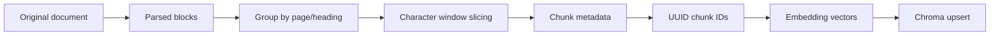
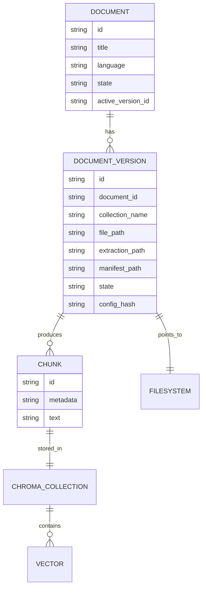

> **2026-10 хэрэгжилтийн шинэчлэл:** Энэ draft-ийг шинэ modular hybrid хувилбарт нийцүүлэн уншина уу. Retrieval одоо active-version dense search болон Unicode-aware version-scoped BM25-г RRF (`k=60`) аргаар нэгтгэнэ; sparse индексийн асуудал dense fallback ба degraded trace үүсгэнэ. Cross-encoder болон conditional rewrite нь opt-in. Query processing Монгол кирилл/латин, English, mixed, unknown ангилалтай; генерац Монгол кирилл шаардаж, citation validation хадгалагдана. Шинэ бодит call graph, lifecycle, тохиргоо, хязгаарлалт нь [08](08-advanced-rag-implementation.md) болон [09](09-multilingual-mongolian-rag.md)-д байна. Доорх анхны baseline тайлбарын хуучирсан хэсгийг шинэ баримтууд орлоно.
# 02. Document Ingestion Pipeline

## 1. Objective

Энэ баримт нь upload хийсэн PDF/DOCX/DOC файлыг хэрхэн боловсруулж, чангаараар хувааж, embedding үүсгээд, Chroma-д хадгалахыг тайлбарлана. Энэ нь RAG системийн "offline/indexing" үе шат бөгөөд хэрэглэгчийн асуултанд бэлэн indexed knowledge үүсгэх үндсэн ажил юм.

## 2. Document ingestion pipeline

```mermaid
flowchart LR
    A["Upload file"] --> B["upload()"]
    B --> C["validate_file()"]
    C --> D["new_version()"]
    D --> E["parse_bounded()"]
    E --> F["parse_direct()"]
    F --> G["normalize() + OCR / DOC conversion"]
    G --> H["chunk()"]
    H --> I["fit_chunks()"]
    I --> J["VectorStore.upsert()"]
    J --> K["DocumentVersion ready"]
    K --> L["Document.active_version_id"]
```

## 3. Stage-by-stage explanation

### 3.1 Upload and file validation

`upload()` нь [app/services/ingestion.py](../app/services/ingestion.py) дотор хэрэгждэг. Тус function нь:

- file extension шалгах (`pdf`, `docx`, `doc`)
- 20 MiB-аас ихгүй эсэхийг шалгах
- SHA-256 hash тооцоолох
- duplicate build байгаа эсэхийг шалгах (`sha256` + config hash)
- upload file-ийг application data directory-д хадгалах

`validate_file()` нь [app/services/parsing.py](../app/services/parsing.py) дотор PDF/DOCX/DOC-ийг бэлэн эсэхийг шалгана. Жишээ нь:

- PDF: encrypted эсэх, page count `PDF_MAX_PAGES`-аас ихгүй эсэх
- DOCX: valid zip archive, Word document structure, macro-bearing document-ийг хориглох
- DOC: legacy binary DOC signature шалгах

### 3.2 Parsing and native extraction

`parse_bounded()` нь:

- subprocess ашиглан parse logic-г бие даасан процессоор гүйцэтгэх
- timeout хэмжих
- `parse_worker.py` тусламжтайгаар `parse_direct()`-д ажилуулна

`parse_direct()` нь:

- DOC файл -> LibreOffice via `convert_doc()` -> DOCX рүү хөрвүүлэх
- DOCX file-ийг `python-docx` ашиглан `Paragraph` болон `Table`-ийг уншина
- PDF file-ийг `pypdf` ашиглаж page extract хийж, `pytesseract`-ээр OCR хийж болно
- page level `native` vs `ocr` шийдлийг `selected` field-д хадгална

### 3.3 Normalization and OCR policy

`normalize()` function нь [app/services/parsing.py](../app/services/parsing.py) дотор:

- NFD/NFC Unicode normalize
- null bytes устгах
- multiple whitespace collapsing
- line by line trim хийх

PDF-д sparse or corrupt text илэрвэл OCR автоматаар ажилна:

- `native` текстийн alphanumeric тоо `OCR_MIN_CHARACTERS`-ээс бага байна
- ``/`�` г.м. corrupt тэмдэгт их байна
- эсвэл `forced_pages` жагсаалтад орсон page

OCR болон native extraction-ийг `candidates` массив дотор хадгалж, `warnings` list-ээр review шаардлагатай нөхцлийг тэмдэглэнэ.

## 4. Chunking deep dive

### 4.1 Actual chunking implementation

`chunk()` function [app/services/chunking.py](../app/services/chunking.py) дотор ажилладаг. Энэ function-ийн логик:

1. `blocks`-ийг page/heading-ээр бүлэглэнэ
2. бүлгийн текстийг `\n\n`-ээр нэгтгэнэ
3. `start` pointer-ээр 1800 char window-ийг зурна
4. `overlap` 250 хүртэл гүйлгэсэн хэсгүүдийг давхардуулна
5. `metadata` объектод `heading`, `page_start`, `page_end`, `char_start`, `char_end`, `block_start`, `block_end`, `extraction_method` зэрэг утгыг нэмнэ
6. `assign_ids()` ашиглан UUID chunk ID үүсгэнэ

### 4.2 Why chunk size and overlap matter

- Чанар муутай чанкууд нь query context-ийг хэт их төвлөрөлгүй болгож, хэрэгтэй мэдээллийг алдахад хүргэдэг
- Хэт их chunk хэмжээ нь semantic retrieval-д чухал уялдаа холбоог алдагдуулна
- Overlap нь boundary-ийг хадгалж, нэг мэдээлэл хоёр chunk-д хуваагдах үед унаж болзошгүй

Энэ төслийн default утгууд нь:

- `CHUNK_SIZE = 1800`
- `CHUNK_OVERLAP = 250`

Эдгээр утгууд [app/config.py](../app/config.py) дотор тодорхойлогдсон.

## 5. Embedding generation and chunk preparation

`Gemini.fit_chunks()` [app/services/gemini.py](../app/services/gemini.py) функц нь chunk-ийг embedding-д бэлдэхэд ашиглагддаг. Энэ function нь:

- chunk text-ийг UTF-8 byte guard-аар шалгана
- 1,900 byte-ээс их бол split хийнэ
- `assign_ids()`-ийг дахин ашиглан шинэ ID үүсгэх боломжийг олгоно

Энэ нь embedding provider-ийн "exact token count" биш, харин консерватив `utf8-1900-v1` guard-ийг хэрэгжүүлдэг. Тодорхой тайлбар: `gemini-embedding-001` нь `count_tokens`-ийг дэмждэггүй учраас, text-ийг босго хэмжээ хүртэл нь хувааж, цааш хэт их input-ийг зөвшөөрөхгүй.

## 6. ChromaDB storage and metadata

`VectorStore.upsert()` [app/services/vectorstore.py](../app/services/vectorstore.py) нь Chroma collection-ийг `get_or_create_collection()`-оор үүсгээд, `documents`, `metadatas`, `embeddings` ба `ids`-ийг upsert хийдэг.

Иймд Chroma-д хадгалагдаж буй мэдээлэл нь:

- chunk text
- embedding vector
- metadata object (`heading`, `page`, `version_id`, `document_id`, `language`, etc.)
- chunk ID

Гэхдээ PostgreSQL-д хадгалагдаж буй үндсэн мэдээллүүд:

- `Document`
- `DocumentVersion`
- `QueryLog`
- `EvaluationRun`

Энэ хоёр нь хоорондоо холбоотой бөгөөд Chroma нь search engine, PostgreSQL нь lifecycle metadata store-оор ажилладаг.

## 7. DocumentVersion / Chroma / filesystem relationship

### 7.1 Verified relationship

- `DocumentVersion`-ийн `collection_name` нь Chroma collection-ын нэрийг заана
- `DocumentVersion.id` нь chunk metadata (`version_id`) дотор хадгалагдана
- `Document.active_version_id` нь хамгийн сүүлд батлагдсан, searchable build-ийг заана
- `manifest_path` болон `extraction_path` нь JSON artifact-уудыг зааж өгдөг
- `file_path` нь оригинал файл руу очдог

Эдгээр холбоосууд нь [app/models.py](../app/models.py) болон [app/services/ingestion.py](../app/services/ingestion.py)-д батлагддаг.

## 8. Index activation flow

Upload -> parse -> approve -> process -> chunk -> embed -> Chroma upsert -> activate version

`process()` function [app/services/ingestion.py](../app/services/ingestion.py) дотор энэ дарааллыг гүйцэтгэдэг:

1. version state-ийг `indexing`-ээр тохируулна
2. extraction artifact-ийг унших
3. `chunk()`-ээр чанкууд үүсгэх
4. `client.embed()`-ээр embedding үүсгэх
5. `VectorStore.upsert()`-ээр Chroma-д хадгалах
6. `ids` verification хийж, manifest үүсгэх
7. `Document.active_version_id`-ийг шинэ version-руу шилжүүлэх

## 9. Error handling and reliability

- `mutation_lock()` function нь нэгэн зэрэг document mutation-ийг нэг process-д хязгаарладаг
- `process()` exception гарвал version state-ийг `failed` болгоно
- `reconcile()` нь incomplete build-ийг repair/mark failed хийж болно
- Chroma verification нь `ids`-ийн тохирол болон manifest-ийг шалгана

## 10. Summary

Энэ RAG индекс үүсгэх pipeline нь "upload -> parse -> chunk -> embed -> upsert -> activate" гэсэн стандарт RAG flow-ийг жинхэнэ кодоор хэрэгжүүлдэг. Гэхдээ advanced RAG techniques (hybrid search, reranking, query rewriting) энд хэрэгжээгүй бөгөөд энэ төсөл нь semantic vector retrieval-ийг анхнаасаа үндэслэн барьсан болно.
