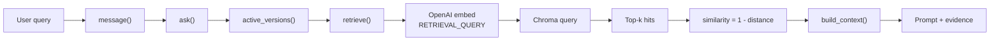
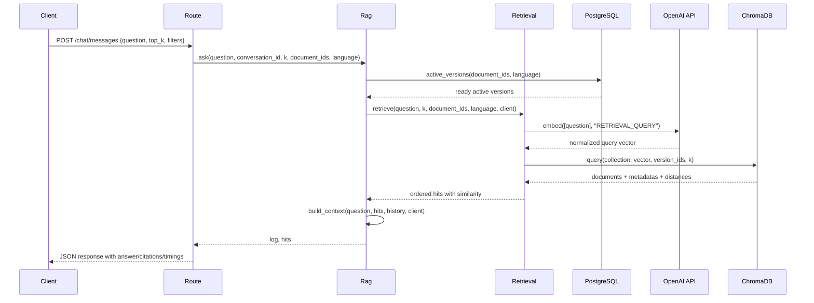

> **2026-10 хэрэгжилтийн шинэчлэл:** Энэ draft-ийг шинэ modular hybrid хувилбарт нийцүүлэн уншина уу. Retrieval одоо active-version dense search болон Unicode-aware version-scoped BM25-г RRF (`k=60`) аргаар нэгтгэнэ; sparse индексийн асуудал dense fallback ба degraded trace үүсгэнэ. Cross-encoder болон conditional rewrite нь opt-in. Query processing Монгол кирилл/латин, English, mixed, unknown ангилалтай; генерац Монгол кирилл шаардаж, citation validation хадгалагдана. Шинэ бодит call graph, lifecycle, тохиргоо, хязгаарлалт нь [08](08-advanced-rag-implementation.md) болон [09](09-multilingual-mongolian-rag.md)-д байна. Доорх анхны baseline тайлбарын хуучирсан хэсгийг шинэ баримтууд орлоно.
# 03. Retrieval Pipeline

## 1. Objective

Энэ баримт нь хэрэглэгч асуулт тавих үед юу болохыг тайлбарлана. Үүнд query embedding, ChromaDB similarity search, active-version filtering, top-k selection, metadata carryover, retrieval result formatting зэрэг алхмууд орно.

## 2. Actual retrieval flow



## 3. Entry point and request flow

`/chat/messages` endpoint [app/routes/chat.py](../app/routes/chat.py) дотор ажилладаг. Энэ endpoint нь:

- JSON/form question-г уншина
- `top_k`-г шалгана (`1, 3, 5, 10`)
- `document_id` filter, `language` filter, `retrieval_only` mode-ийг уншина
- `ask()`-ийг дууцгаана

`ask()` [app/services/rag.py](../app/services/rag.py) нь:

- question trim хийх
- `QueryLog` үүсгэх
- `active_versions(document_ids, language)`-ээр идэвхтэй баримтуудыг олно
- `retrieve()`-ийг дууцгаана
- `retrieval_only` үед generation-гүйгээр зогсох боломжтой
- answer generation үед `build_context()` болон `OpenAIProvider.generate()`-ийг дууцгаана

## 4. Active version filtering

`active_versions()` function [app/services/retrieval.py](../app/services/retrieval.py) нь PostgreSQL-ээс идэвхтэй document version-уудыг авна.

Логик:

```python
statement = select(DocumentVersion, Document).join(Document, Document.active_version_id == DocumentVersion.id)
statement = statement.where(Document.state == "active", DocumentVersion.state == "ready")
```

Иймээс query нь:

- устгагдаагүй
- идэвхтэй
- ready state-тэй
- зөвхөн актуал баримт хувилбаруудыг хайна

Энэ нь Chroma-д stale or deleted vectors-ийг оруулахаас сэргийлнэ.

## 5. Query embedding

Retrieve pipeline дэх `client.embed([question], "RETRIEVAL_QUERY")`-ийг [app/services/retrieval.py](../app/services/retrieval.py) дотор гүйцэтгэдэг.

- OpenAI SDK-ийн `embeddings.create` endpoint ашиглана
- query model нь `RETRIEVAL_QUERY` task type-ээр ажиллана
- vector нь `EMBEDDING_DIMENSIONS`-ийн дагуу normalized байна
- `app/services/vectors.py::normalize_vector()` нь L2 normalization хийж, хүчингүй болон zero vector-ийг reject хийнэ

## 6. Vector similarity and distance metric

`VectorStore` [app/services/vectorstore.py](../app/services/vectorstore.py) нь Chroma collection-ийг `configuration={"hnsw": {"space": "cosine", "batch_size": 1, "sync_threshold": 1}}`-ээр үүсгэнэ.

Чухал баримт:

- Chroma collection нь cosine space ашигладаг
- query result-ээс буцах `distance` утга нь cosine distance боломжтой
- code дээр `similarity = 1 - hit["distance"]` гэж тооцоологдоно
- `distance` бага байх тусам илүү ойр байна
- `similarity` их байх тусам илүү релевант байна

Тиймээс энэ төсөл "lower distance = better match" принципийг хэрэглэдэг.

## 7. Top-k retrieval and candidate selection

`VectorStore.query()` [app/services/vectorstore.py](../app/services/vectorstore.py) нь:

```python
collection.query(query_embeddings=[vector], n_results=k, where={"version_id": {"$in": version_ids}}, include=["documents", "metadatas", "distances"])
```

Үүнд:

- `version_id` filter ашиглан зөвхөн идэвхтэй document versions-ийг хасна
- `k` утга default `TOP_K` (5) байна
- `n_results`-тэйгаар хайлтын үр дүнгийн тоо хязгаарлагддаг
- `hits`-ийг `distance` сортлуулна

`retrieve()` function-д:

```python
hits = sorted(hits, key=lambda h: (h["distance"], h["id"]))[:k]
```

Тэгэхээр хамгийн ойр hits-ийг эхэнд авч, дараа нь `similarity` нэмнэ.

## 8. Metadata filtering and corpus constraints

`message()` endpoint нь:

- `document_id` filter холбоно
- `language` filter боломжтой (`mn`, `en`, `mixed`)
- `ask()` -> `active_versions(document_ids, language)`-ээр filter төлөв байдлыг ашиглана

Энэ нь:

- тодорхой баримтаар хязгаарлах
- Mongolian/English language split-ийг дагах
- index mixing-ээс өмнө стоплох

Энэ төсөлд metadata filtering нь "document and language selection" хүртэл хязгаарлагддаг; advanced RAG-д түгээмэл хэрэглэгддэг BM25 / sparse filter / hybrid fusion, reranking зэрэггүй.

## 9. Retrieval failure scenarios

`retrieve()` function нь дараах нөхцөлд алдаа үүсгэж болно:

- active index uses different embedding space
- `top_k` invalid
- no active versions
- Chroma collection not found
- document changed during retrieval (`still_active(hits)`)

`ask()` дасгалдаа:

- `still_active(hits)` шалгаад, document state өөрчлөгдсөн үед retry хийх боломжтой
- хэрэв corpus байхгүй бол `hits` хоосон үлдэж, generation-ийг эхлүүлдэггүй

## 10. Sequence diagram of actual retrieval



## 11. Important observations

1. This project uses semantic retrieval only; sparse lexical search is not implemented.
2. Chroma stores vector and metadata; PostgreSQL owns active-version decisions.
3. Retrieval is independent from generation; `retrieval.py` is decoupled from `rag.py`.
4. `similarity` is derived from cosine distance, not a separate ranking model.
5. There is no reranker, no hybrid fusion, no query expansion, and no BM25 integration in the observed code.

## 12. Summary

Энэ төсөлд retrieval pipeline нь "question -> embed -> semantic search -> top-k selection -> evidence context" гэсэн стандарт RAG зохион байгуулалтыг дагаж мөрддөг. Гэхдээ advanced ranker, hybrid retrieval, query rewriting, cross-encoder reranking зэрэг техники одоогоор үйл ажиллагаанд харагдахгүй байна.
