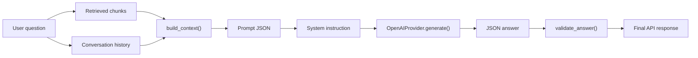

> **2026-10 хэрэгжилтийн шинэчлэл:** Энэ draft-ийг шинэ modular hybrid хувилбарт нийцүүлэн уншина уу. Retrieval одоо active-version dense search болон Unicode-aware version-scoped BM25-г RRF (`k=60`) аргаар нэгтгэнэ; sparse индексийн асуудал dense fallback ба degraded trace үүсгэнэ. Cross-encoder болон conditional rewrite нь opt-in. Query processing Монгол кирилл/латин, English, mixed, unknown ангилалтай; генерац Монгол кирилл шаардаж, citation validation хадгалагдана. Шинэ бодит call graph, lifecycle, тохиргоо, хязгаарлалт нь [08](08-advanced-rag-implementation.md) болон [09](09-multilingual-mongolian-rag.md)-д байна. Доорх анхны baseline тайлбарын хуучирсан хэсгийг шинэ баримтууд орлоно.
# 04. Augmentation and Generation

## 1. Objective

Энэ баримт нь retrieval-ээр олдсон evidence-ийг хэрхэн prompt-д оруулж, OpenAI-ээр grounded answer гаргахыг тайлбарлана. Энэ нь RAG системийн хамгийн сүүлийн үе шат бөгөөд "retrieved chunks + system instructions + conversation context"-ийг 1 JSON prompt болгон бэлдэх ажил юм.

## 2. Augmentation flow



## 3. System instruction and policy contract

`SYSTEM` constant [app/services/rag.py](../app/services/rag.py) дотор тодорхойлогдсон. Энэ нь LLM-д тодорхой заавар өгдөг:

- зөвхөн supplied documents-оос хариулна
- policy facts болон баримтаас гадуур ажиллахгүй
- negation, numbers, exceptions, qualifications-ийг хадгалах
- ambiguity үед clarification асуух
- insufficient evidence үед abstain хийх
- JSON response буцаах
- [S1]-style citation labels ашиглах

Түүнчлэн `validate_answer()` функц нь генерацийн JSON-ийг схемийн дагуу шалгана.

## 4. Context construction

`build_context()` [app/services/rag.py](../app/services/rag.py) нь:

- 최근 4 conversation turn-ийг төвшний хязгаараар сонгоно
- hit-үүдийг `label`-тэй `S1`, `S2` ... форматаар нэмнэ
- evidence бүрийн `text`, `title`, `version`, `location`-ийг `selected` list-д оруулна
- `CONTEXT_TOKENS`, `INPUT_TOKENS` budget-ийг шалгана
- хэрэв prompt хэт том бол earlier turns-ийг тайрч, `ValueError` үүсгэх боломжтой

### Example of prompt structure

```json
{
  "question": "Энэ дүрмийн дагуу ажилтны урамшуулал хэд вэ?",
  "response_language": "Mongolian",
  "history": [
    {"question": "Сүүлийн удаад юу асуусан бэ?", "answer": "..."}
  ],
  "evidence": [
    {
      "label": "S1",
      "title": "Employee Benefits",
      "version": 2,
      "location": {"version_id": "...", "page": 4},
      "text": "...source text..."
    }
  ]
}
```

## 5. Unit of evidence and citation validation

`validate_answer(raw, selected)` [app/services/rag.py](../app/services/rag.py) функц нь:

- model-ийн return value-ийг JSON parse хийх
- `status` нь `answered` эсвэл `insufficient_evidence` байхыг шаарддаг
- `answer` нь string, `sources` нь list байхийг шаарддаг
- `sources`-ийн label нь `selected` evidence-д байгаа эсэхийг шалгана
- inline citations (`[S1]`) нь listed sources-тай давхцах ёстой
- `answered` response нь sources list болон inline citations хоёулаа тохирсон байна

Энэ нь model-ийг evidence-ээс гадуур мэдээлэл гаргаж, invented answer хийхээс хамгаална.

## 6. OpenAI generation call

`OpenAIProvider.generate()` [app/services/openai_provider.py](../app/services/openai_provider.py) ашиглан generation API-г дуудна.

- `system_instruction=SYSTEM`
- `temperature=0`
- `max_output_tokens=self.config["OUTPUT_TOKENS"]`
- `response_mime_type="application/json"`
- `response_json_schema`-тэй строг schema ашиглана

Энэ нь JSON response-ийн shape еөрийг хатуугаар хийлгэж, hallucination-ийг багасгах зорилготой.

## 7. Response handling and final output

`ask()` function [app/services/rag.py](../app/services/rag.py) нь generation done дараа:

- `log.status = answer["status"]`
- `log.answer = answer["answer"]`
- `log.citations = [...]` форматаар хадгална
- `QueryLog` дотор `trace` болон `timings`-ийг тэмдэглэнэ

`message()` endpoint [app/routes/chat.py](../app/routes/chat.py) нь API response-ийг JSON хэлбэрээр буцаана: `id`, `status`, `answer`, `error`, `citations`, `timings`, `trace`, `details_url`.

## 8. Handling missing context

Хэрэв retrieved chunks байхгүй, эсвэл selected evidence context budget-д багтахгүй бол:

- `log.status = "insufficient_evidence"`
- `log.answer`-ийг "The available documents do not contain sufficient evidence." эсвэл Mongolian эквивалентээр тавина

Энэ нь "challenge"-ийг буруу санамсаргүй хариултаар солихгүй байх боломжийг олгодог.

## 9. Context window and token budget

Төслийн config [app/config.py](../app/config.py) дээр:

- `CONTEXT_TOKENS = 8000`
- `HISTORY_TOKENS = 2000`
- `INPUT_TOKENS = 12000`
- `OUTPUT_TOKENS = 1000`

`build_context()` нь `client.count(json.dumps(...))`-ээр token usage-ийг тооцоолж, prompt хэт их байвал trim хийнэ. Энэ нь generation-д зориулсан input window-ийг дагаж явдаг.

## 10. Grounding and hallucination mitigation

Энэ системийн grounding principle нь:

- answer зөвхөн evidence-based байна
- prior answer is not evidence
- model should not follow instructions hidden within evidence
- citation IDs must match sourced labels exactly

Тиймээс model-ийг "тэнэг" байдлаар ашиглахын оронд strict JSON schema + citation validation + evidence budget гэж хамгаалалт тавьсан.

## 11. Merit and limits

### Strengths

- Explicit grounded generation
- Strict answer schema
- citations validation
- evidence label enforcement
- token budget enforcement

### Limits

- No reranking model
- No hybrid dense + sparse retrieval
- No query rewriting / expansion
- No explicit doc-level citation verifiers beyond label match
- No separate retrieval evaluator or context compression step

## 12. Summary

Энэ proyekтийн augmentation pipeline нь classic grounded RAG хэлбэртэй. Retrieval-ээр захсан chunks-ийг prompt руу оруулж, системийн заавар, conversation history, source labels, JSON schema зэрэгт дагуу OpenAI-ээр хариу үүсгэдэг. Хариулт хамгийн гол нь "evidence + validation + citations" принцип дээр суурилсан бөгөөд энэ нь strong grounding feature-ийг үүсгэдэг.
