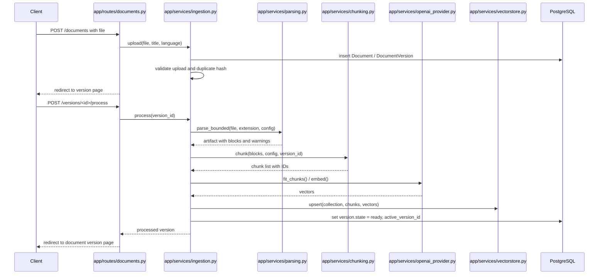
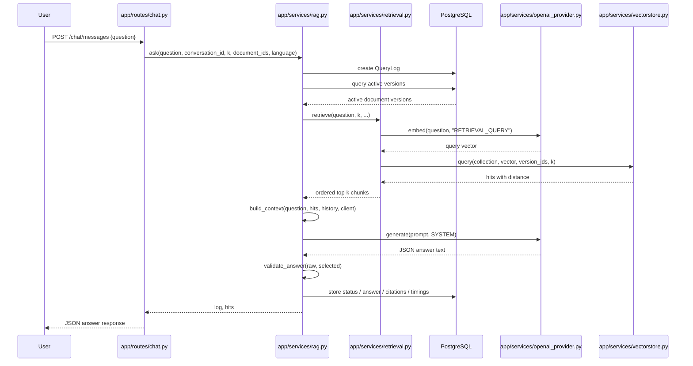

> **2026-10 хэрэгжилтийн шинэчлэл:** Энэ draft-ийг шинэ modular hybrid хувилбарт нийцүүлэн уншина уу. Retrieval одоо active-version dense search болон Unicode-aware version-scoped BM25-г RRF (`k=60`) аргаар нэгтгэнэ; sparse индексийн асуудал dense fallback ба degraded trace үүсгэнэ. Cross-encoder болон conditional rewrite нь opt-in. Query processing Монгол кирилл/латин, English, mixed, unknown ангилалтай; генерац Монгол кирилл шаардаж, citation validation хадгалагдана. Шинэ бодит call graph, lifecycle, тохиргоо, хязгаарлалт нь [08](08-advanced-rag-implementation.md) болон [09](09-multilingual-mongolian-rag.md)-д байна. Доорх анхны baseline тайлбарын хуучирсан хэсгийг шинэ баримтууд орлоно.
# 05. End-to-End Execution Flow

## 1. Objective

Энэ баримт нь системийн бүхэл бүтэн lifecycle-ийг хоёр том мөчөөр дамжуулан тайлбарлана:

1. Document upload -> searchable knowledge creation
2. User question -> grounded answer generation

## 2. Diagram A: Document upload to searchable knowledge

### Diagram A explanation

- Upload action нь [app/routes/documents.py](../app/routes/documents.py) `upload()`-аас эхэлнэ
- `upload()` function нь file signature, size, hash, duplicate build, document version үүсгэх зэрэг үйлдлийг хийж, PostgreSQL-д metadata-г хадгална
- `process()` function [app/services/ingestion.py](../app/services/ingestion.py) дээр parse -> chunk -> embed -> upsert 순 дарааллыг явуулна
- `parse_bounded()` нь subprocess дотор ажилладаг. Энэ нь long-running native parsing / OCR-ийг web request thread-оос тусдаа гүйцэтгэдэг
- Embedding үүсгэсний дараа `VectorStore.upsert()`-ээр Chroma-д хадгална
- Зөвхөн `DocumentVersion.state = "ready"` үед indexed corpus нь searchable-ээр идэвхждэг

## 3. Diagram B: User query to generated response

### Diagram B explanation

- `/chat/messages` endpoint нь question, top_k, document filter, language filter, retrieval_only flags-ийг авна
- `ask()`-ийн эхний алхам нь `QueryLog` үүсгэх бөгөөд энэ нь trace болон telemetry-ийг хадгална
- `retrieve()` нь PostgreSQL-оос active versions-ийг авсны дараа Chroma-д semantic query хийж, top-k hit-ийг буцаана
- `build_context()` нь selected hit-үүдийг prompt руу оруулж, token budget-ийг хянаж, `SYSTEM` instruction-тай нэгтгэнэ
- `OpenAIProvider.generate()`-ийн return value нь strict JSON schema-тай байх шаардлагатай
- `validate_answer()` нь citations болон sources-ийг шалгаж, invalid answer-ыг reject хийж болно

## 4. Sample realistic question trace

### Question example

"Тавдугаар сарын сургалтын хөтөлбөрийн нөхцөл юу вэ?"

### Actual flow

1. Client sends HTTP POST to `/chat/messages`
2. `message()` parses `question` and optional `document_id`/`language` filters
3. `ask()` creates `QueryLog`
4. `active_versions()` filters only active + ready versions
5. Query question is embedded via `OpenAIProvider.embed(..., "RETRIEVAL_QUERY")`
6. Each eligible Chroma collection is queried with the vector
7. Hits are sorted by `distance`, then converted to `similarity = 1 - distance`
8. `build_context()` selects the evidence within the token budget and labels them `S1`, `S2`, ...
9. `OpenAIProvider.generate()` receives a JSON prompt and returns a grounded answer plus citations
10. `validate_answer()` confirms inline citations match source labels
11. `QueryLog` stores `answer`, `status`, `citations`, `timings`, `usage`, `trace`
12. Client receives final JSON with answer and metadata

## 5. Data movement summary

| Step | Data moved | Where it lives |
|---|---|---|
| Upload | file bytes + filename + metadata | filesystem + PostgreSQL |
| Parse | blocks + warnings + candidates | extraction JSON artifact |
| Chunk | text segments + metadata + UUID IDs | in-memory -> Chroma |
| Embed | float vectors | Chroma |
| Query | question string + query vector | in-memory + OpenAI API |
| Retrieve | chunk text + metadata + distance | Chroma result |
| Generate | prompt JSON + evidence + system instruction | OpenAI API request |
| Persist | answer, citations, trace, timings | PostgreSQL |

## 6. Error propagation and resilience

- Parse errors are caught in `parse_bounded()` and surfaced as `ValueError`
- `process()` wraps the whole indexing path and sets the version to `failed`
- `query` errors caused by stale/corrupted active versions are caught in `ask()` and logged as query error
- `OpenAIProvider.generate()` failures or invalid JSON returns are re-tried and validated before answer is accepted
- `still_active(hits)` checks prevent answering from documents that changed mid-flight

## 7. Important implementation detail

This system does not implement a background queue. Long-running tasks are synchronous in the request lifecycle. The README explicitly states that document processing blocks the request and there is no scheduler or worker queue. This affects the end-to-end execution model and is important for understanding the system's operational behavior.

## 8. Summary

Энэ системийн end-to-end lifecycle нь: upload -> parse -> chunk -> embed -> Chroma upsert -> question -> embed -> retrieve -> context build -> OpenAI generation -> validate -> persist answer. Энэ нь local, synchronous, grounded RAG sample implementation бөгөөд query, retrieval, generation, telemetry-ийн бүх гүйцэтгэл нь код дээр шууд харагдана.
