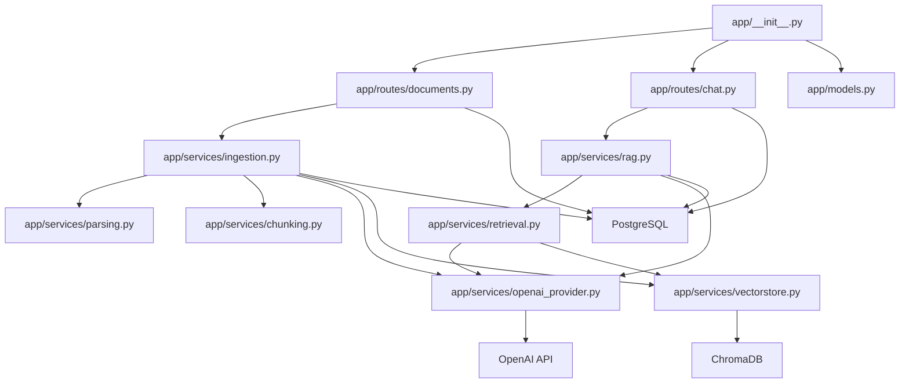
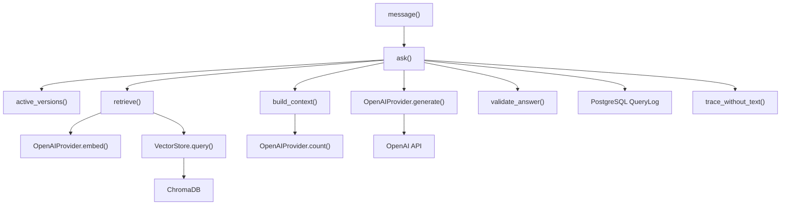
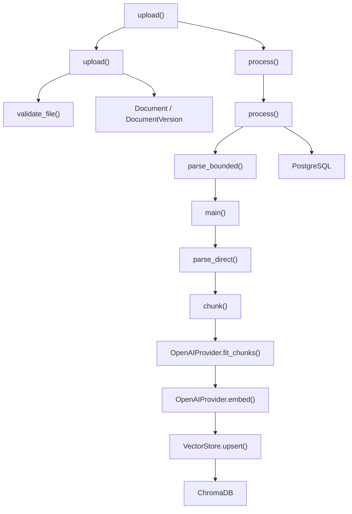
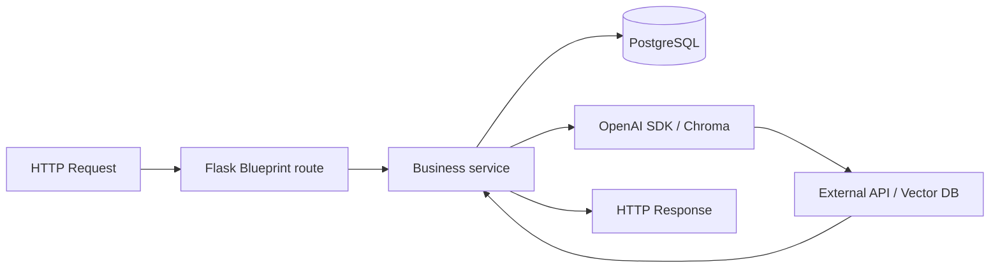

> **2026-10 хэрэгжилтийн шинэчлэл:** Энэ draft-ийг шинэ modular hybrid хувилбарт нийцүүлэн уншина уу. Retrieval одоо active-version dense search болон Unicode-aware version-scoped BM25-г RRF (`k=60`) аргаар нэгтгэнэ; sparse индексийн асуудал dense fallback ба degraded trace үүсгэнэ. Cross-encoder болон conditional rewrite нь opt-in. Query processing Монгол кирилл/латин, English, mixed, unknown ангилалтай; генерац Монгол кирилл шаардаж, citation validation хадгалагдана. Шинэ бодит call graph, lifecycle, тохиргоо, хязгаарлалт нь [08](08-advanced-rag-implementation.md) болон [09](09-multilingual-mongolian-rag.md)-д байна. Доорх анхны baseline тайлбарын хуучирсан хэсгийг шинэ баримтууд орлоно.
# 06. Codebase File and Function Map

## 1. Objective

Энэ баримт нь төслийн бодит файл, class, function, dependency, database access, external API calls, data movement-ийг нэг дор харуулна. Энэ нь "source-to-execution" mapping бөгөөд архитектурын багц бүрэлдэхүүн хэсгүүдийн хариуцлагыг тодорхойлох зорилготой.

## 2. Actual file dependency graph

## 3. Function-level call graph for question answering

## 4. Document ingestion function graph

## 5. Request execution path

## 6. File-to-function map

| File | Main responsibility | Key functions / classes | External deps | Notes |
|---|---|---|---|---|
| [app/__init__.py](../app/__init__.py) | app factory and middleware | `create_app()`, `health()`, `local_csrf()` | Flask, SQLAlchemy, Migrate | route registration and config initialization |
| [app/config.py](../app/config.py) | runtime settings | `settings()`, `validate()` | environment variables | default config values |
| [app/models.py](../app/models.py) | persistence schema | `Document`, `DocumentVersion`, `QueryLog` | SQLAlchemy | metadata and logs |
| [app/extensions.py](../app/extensions.py) | DB extension setup | `db`, `migrate` | Flask-SQLAlchemy, Flask-Migrate | session configuration |
| [app/routes/documents.py](../app/routes/documents.py) | document lifecycle UI/API | `upload()`, `process()`, `approve()`, `reindex()`, `delete()` | Flask, SQLAlchemy | document operations |
| [app/routes/chat.py](../app/routes/chat.py) | chat and query UI/API | `message()`, `query()`, `evaluation()` | Flask, SQLAlchemy | user-facing query flow |
| [app/services/ingestion.py](../app/services/ingestion.py) | document indexing pipeline | `upload()`, `process()`, `approve()`, `reindex()`, `delete_document()` | PostgreSQL, Chroma, OpenAI | main orchestration |
| [app/services/parsing.py](../app/services/parsing.py) | extraction and OCR | `normalize()`, `validate_file()`, `convert_doc()`, `parse_direct()`, `parse_bounded()` | pypdf, python-docx, OCR dependencies | PDF/DOCX/DOC parsing |
| [app/services/chunking.py](../app/services/chunking.py) | chunk slicing | `chunk()`, `assign_ids()` | filesystem metadata | chunk windowing |
| [app/services/openai_provider.py](../app/services/openai_provider.py) | OpenAI SDK wrapper | `OpenAIProvider`, `count()`, `fit_chunks()`, `embed()`, `generate()` | OpenAI SDK | Embedding, token counting, and generation |
| [app/services/vectorstore.py](../app/services/vectorstore.py) | Chroma abstraction | `VectorStore`, `collection()`, `upsert()`, `query()`, `delete_version()` | chromadb | vector storage |
| [app/services/retrieval.py](../app/services/retrieval.py) | retrieval orchestration | `active_versions()`, `still_active()`, `retrieve()` | SQLAlchemy, Chroma, OpenAI | search layer |
| [app/services/rag.py](../app/services/rag.py) | orchestration + validation | `language_of()`, `build_context()`, `validate_answer()`, `ask()` | PostgreSQL, OpenAI | prompt build and answer validation |
| [app/services/storage.py](../app/services/storage.py) | filesystem helpers | `root()`, `fingerprint()`, `path()`, `write_json()`, `read_json()` | `flask.current_app` | data artifact management |
| [app/services/parse_worker.py](../app/services/parse_worker.py) | subprocess parser | `main()` | Python subprocess | bounded extraction worker |

## 7. Important role assignments

### API handling

- [app/routes/documents.py](../app/routes/documents.py): upload, process, review, delete
- [app/routes/chat.py](../app/routes/chat.py): query intake, retrieval, evaluation UI

### Core RAG orchestration

- [app/services/ingestion.py](../app/services/ingestion.py): indexing lifecycle
- [app/services/retrieval.py](../app/services/retrieval.py): retrieval lifecycle
- [app/services/rag.py](../app/services/rag.py): prompt construction, validation, final answer orchestration

### Document processing

- [app/services/parsing.py](../app/services/parsing.py): native parse + OCR
- [app/services/chunking.py](../app/services/chunking.py): chunk creation

### Embedding

- [app/services/openai_provider.py](../app/services/openai_provider.py): `OpenAIProvider.embed()` and `fit_chunks()`

### Vector database

- [app/services/vectorstore.py](../app/services/vectorstore.py): `VectorStore.query()`, `upsert()`, `delete_version()`

### PostgreSQL

- [app/models.py](../app/models.py): schema
- [app/services/retrieval.py](../app/services/retrieval.py): active version selection
- [app/routes/chat.py](../app/routes/chat.py): log retrieval and query history

### LLM communication

- [app/services/openai_provider.py](../app/services/openai_provider.py): `OpenAIProvider.generate()` and token counting

### Configuration

- [app/config.py](../app/config.py): defaults and validation

### Response formatting

- [app/routes/chat.py](../app/routes/chat.py): JSON response structure
- [app/services/rag.py](../app/services/rag.py): answer validation and source labeling

## 8. Verified behavioral findings

- There is no dedicated `services/rag_service.py` file; the real orchestration is in [app/services/rag.py](../app/services/rag.py).
- There is no standalone `llm_service.py` file; OpenAI integration is in [app/services/openai_provider.py](../app/services/openai_provider.py).
- `DocumentVersion` is the authoritative versioned unit; Chroma collections are keyed by version collection names.
- Search only touches active versions that are still `ready` and whose `Document.state == "active"`.
- Grounded answer validation is a real implementation detail, not just a conceptual idea.

## 9. Summary

Энэ төсөл нь модульчлагдсан, гэхдээ нэг төрлийн "small local RAG" бүтэцтэй. App layers нь route -> service -> SQL/Chroma/OpenAI breakdown-тай ажилладаг. Хамгийн гол нь Chroma нь vector storage, PostgreSQL нь lifecycle metadata storage, OpenAI нь embedding + generation provider, [app/services/rag.py](../app/services/rag.py) нь orchestration болон grounded validation layer-ийг гүйцэтгэдэг.
