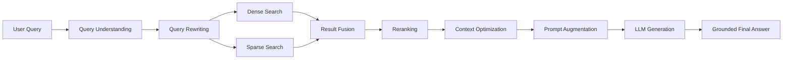

> **2026-10 хэрэгжилтийн шинэчлэл:** Энэ draft-ийг шинэ modular hybrid хувилбарт нийцүүлэн уншина уу. Retrieval одоо active-version dense search болон Unicode-aware version-scoped BM25-г RRF (`k=60`) аргаар нэгтгэнэ; sparse индексийн асуудал dense fallback ба degraded trace үүсгэнэ. Cross-encoder болон conditional rewrite нь opt-in. Query processing Монгол кирилл/латин, English, mixed, unknown ангилалтай; генерац Монгол кирилл шаардаж, citation validation хадгалагдана. Шинэ бодит call graph, lifecycle, тохиргоо, хязгаарлалт нь [08](08-advanced-rag-implementation.md) болон [09](09-multilingual-mongolian-rag.md)-д байна. Доорх анхны baseline тайлбарын хуучирсан хэсгийг шинэ баримтууд орлоно.
# 07. Advanced RAG Techniques

## 1. Classification of the current project

Энэ төслийг тодорхой ангилахад хамгийн тохиромжтой нь "partially advanced / hybrid-lite but not full advanced RAG" гэж үзэх явдал юм. Шалтгаан нь:

- semantic vector retrieval нь хэрэгжсэн
- grounded generation, source labeling, answer validation нь бий
- active-version filtering, query logs, evaluation pipeline нь бий
- гэхдээ advanced techniques such as hybrid dense+sparse retrieval, BM25, reranking, query rewriting, multi-query retrieval, context compression, parent-child indexing, multi-stage retrieval, metadata-aware rerankers тодорхойгүй/хэрэгжээгүй

Иймээс төсөл нь "basic semantic RAG"-ээс дээш, гэхдээ "full advanced RAG" биш гэж үзэх нь хамгийн бодитой.

## 2. Advanced RAG reference architecture

Энэ диаграм нь "conceptual advanced RAG" reference бөгөөд төслийн аль нэг хэсгийг тавьж байгаа зүйл биш. Төслийн одоогийн реалентаци нь энэ жагсаалтын зөвхөн subset-ийг хэрэгжүүлдэг.

## 3. Technique-by-technique analysis

| Technique | What it is | Why useful | Current project status | Evidence |
|---|---|---|---|---|
| Query Rewriting | Question-ийг clearer or expanded form | better retrieval on ambiguous prompts | Not implemented | No rewrite logic in [app/services/rag.py](../app/services/rag.py) |
| Query Expansion | Add synonyms/variants | better recall | Not implemented | No expansion path found |
| Multi-Query Retrieval | Fire several queries and fuse results | better coverage | Not implemented | No multi-query code |
| Hybrid Search | Dense + sparse | lexical + semantic fusion | Not implemented | Only `VectorStore.query()` semantic search exists |
| BM25 | keyword ranking | exact match for names, codes, IDs | Not implemented | No keyword index or BM25 code |
| Reciprocal Rank Fusion (RRF) | combine rank lists | result fusion | Not implemented | No fusion layer |
| Cross-Encoder Reranking | re-rank top candidates | better ordering | Not implemented | No post-retrieval ranker |
| Contextual Retrieval | enrich chunks with surrounding context | better chunk fidelity | Not implemented | No parent/child or context expansion |
| Parent-Child Retrieval | hierarchical chunk retrieval | long-doc understanding | Not implemented | No hierarchy observed |
| Multi-Stage Retrieval | retrieve -> rerank -> compress | better precision | Not implemented | Only one semantic retrieval stage |
| Semantic Chunking | chunk by meaning, not fixed size | context coherence | Partially implemented as fixed-size chunking | [app/services/chunking.py](../app/services/chunking.py) |
| Hierarchical Chunking | coarse + fine chunks | doc structure awareness | Not implemented | No hierarchy found |
| Metadata-Aware Retrieval | filter by doc/language/metadata | support constrained search | Implemented partially | [app/services/retrieval.py](../app/services/retrieval.py) |
| Context Compression | summarize evidence before generation | manage context window | Not implemented | No summarization layer |
| Lost-in-the-Middle | middle-of-context truncation issue | better ordering of evidence | Not addressed explicitly | No evidence of context ordering strategy beyond simple selection |
| Grounded Generation | rely on evidence in prompt | reduce hallucination | Implemented | [app/services/rag.py](../app/services/rag.py) |
| Citation Verification | ensure answers cite provided evidence | reduce unsupported claims | Implemented | `validate_answer()` |
| Retrieval Evaluation | Recall@K, MRR, nDCG | measure quality | Implemented in evaluation module | [app/evaluation.py](../app/evaluation.py) |
| Faithfulness / Answer Relevance | measure truthfulness and answer quality | evaluate RAG quality | Supported as human review fields | [app/models.py](../app/models.py) |
| RAG Observability / Tracing | record queries, timings, hits | production debugging | Implemented | `QueryLog`, `timings`, `trace` |

## 4. Detailed technique explanations

### 4.1 Query Rewriting

**What it is:** User question-ийг өөрчилж, clearer query болгон хувиргах.  
**How it works:** LLM эсвэл rule-based helper rephrases question to improve retrieval.  
**Why useful:** Ambiguous or underspecified queries benefit from rewrite.  
**Current status:** Not implemented.

### 4.2 Query Expansion

**What it is:** Same intent translated into multiple related queries.  
**Why useful:** increases recall on synonym-heavy corpora.  
**Current status:** Not implemented.

### 4.3 Multi-Query Retrieval

**What it is:** Use several query variants and combine results.  
**Why useful:** improves recall and handles vocabulary mismatch.  
**Current status:** Not implemented.

### 4.4 Hybrid Search (Dense + Sparse)

**What it is:** semantic vector search + lexical keyword search combined.  
**Why useful:** exact names, IDs, policies are often better captured by BM25 or keyword matching.  
**Current status:** Not implemented. Existing system uses Chroma cosine vector search only.

### 4.5 BM25

**What it is:** lexical ranking using term frequency and inverse document frequency.  
**Why useful:** code references, policy names, numbers, and document IDs often retrieve better with exact lexical matching.  
**Current status:** Not implemented.

### 4.6 Reciprocal Rank Fusion (RRF)

**What it is:** combine multiple search result lists by rank, not raw scores.  
**Why useful:** fuses dense + sparse results robustly.  
**Current status:** Not implemented.

### 4.7 Cross-Encoder Reranking

**What it is:** use a model to score candidate passages after initial retrieval.  
**Why useful:** improves ordering of top-k candidates before prompt construction.  
**Current status:** Not implemented.

### 4.8 Contextual Retrieval

**What it is:** retrieve context with surrounding metadata or related document segments.  
**Why useful:** chunk granularity often misses surrounding semantics.  
**Current status:** Not implemented.

### 4.9 Parent-Child Retrieval

**What it is:** keep a parent summary or section overview and child chunks.  
**Why useful:** retrieval precision improves for long documents.  
**Current status:** Not implemented.

### 4.10 Multi-Stage Retrieval

**What it is:** initial retrieval -> rerank -> refine prompt.  
**Why useful:** better precision and reduced context noise.  
**Current status:** Not implemented.

### 4.11 Semantic Chunking

**What it is:** chunks follow semantic boundaries rather than fixed char counts.  
**Why useful:** keeps facts together.  
**Current status:** Partially present: fixed char windows are used, but not semantic chunking.

### 4.12 Hierarchical Chunking

**What it is:** coarse and fine-level retrieval units.  
**Why useful:** long docs and summarization.  
**Current status:** Not implemented.

### 4.13 Metadata-Aware Retrieval

**What it is:** retrieval constrained by document_id, language, or metadata.  
**Why useful:** keep corpus clean and policy scoped.  
**Current status:** Implemented partially via `document_ids` and `language` filters in [app/services/retrieval.py](../app/services/retrieval.py).

### 4.14 Context Compression

**What it is:** summarize or compress evidence before injecting into prompt.  
**Why useful:** reduce context size and preserve relevant facts.  
**Current status:** Not implemented.

### 4.15 Lost-in-the-Middle Problem

**What it is:** LLMs may ignore evidence placed in the middle of a long prompt.  
**Why useful:** prompt ordering matters.  
**Current status:** Not explicitly addressed, although evidence ordering is done by retrieval ranking and then prompt creation.

### 4.16 Grounded Generation

**What it is:** answer strictly from supplied evidence.  
**Why useful:** reduces unsupported claims.  
**Current status:** Implemented in [app/services/rag.py](../app/services/rag.py) via `SYSTEM` instructions and `validate_answer()`.

### 4.17 Citation Verification

**What it is:** check that answer citations correspond to provided evidence.  
**Why useful:** correctness while generating grounded answers.  
**Current status:** Implemented.

### 4.18 Retrieval Evaluation (Recall@K, MRR, nDCG)

**What it is:** quality metrics for retrieval.  
**Why useful:** compare retrieval quality across model and chunk changes.  
**Current status:** Implemented in [app/evaluation.py](../app/evaluation.py) and [app/models.py](../app/models.py).

### 4.19 Faithfulness and Answer Relevance

**What it is:** ensure answer is truthful and relevant to the asked question.  
**Why useful:** quality control.  
**Current status:** Available as evaluation/review fields but not auto-scored beyond syntactic validation.

### 4.20 RAG Observability and Tracing

**What it is:** record retrieval hits, usage, timings, and response traces.  
**Why useful:** debugging and diagnosis.  
**Current status:** Implemented via `QueryLog` and `trace` records in [app/models.py](../app/models.py) and [app/services/rag.py](../app/services/rag.py).

## 5. Practical recommendation for this codebase

Based on the actual source code, the most useful next improvements are:

1. Hybrid Search (dense + sparse)
2. Reranking of top-k hits before prompt assembly
3. Query rewriting for ambiguous Mongolian or English questions
4. Metadata-aware retrieval improvements for document/language constraints
5. Optional context compression if prompt windows become tight

These are recommended only as future enhancements—not as current implementation claims.

## 6. Summary

Энэ төслийг "Advanced RAG" гэж нэрлэхийн өмнө current implementation-ийг нягт харах хэрэгтэй. Оноос хойш семантик retrieval, grounded generation, evaluation, and observability-ийг ашигладаг ч hybrid search, reranking, query rewrite, BM25, hierarchical retrieval, parent-child indexing зэрэг acclaimed advanced techniques энд хараахан орж ирээгүй байна. Иймээс кодын жинхэнэ ангилал нь "partially advanced semantic RAG" гэж хамгийн оновчтой.
