Энэ баримт нь одоогийн Flask хэрэгжилтийн зан төлөвийг тайлбарлана. Mermaid зураг нийт 15 бөгөөд зураг бүрийн дараа холбогдох эх кодын entry point-ийг нэрлэв.

## 1. Архитектур ба индексийн амьдралын мөчлөг

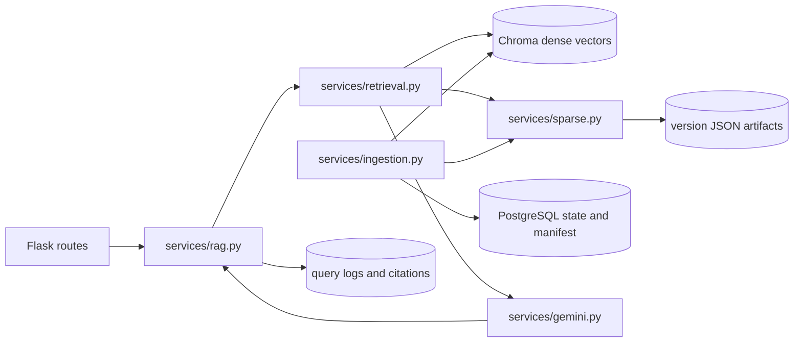
Factory нь `app/__init__.py:create_app`; route нь `app/routes/chat.py:message`; гол оркестрац нь `app/services/rag.py:ask`.

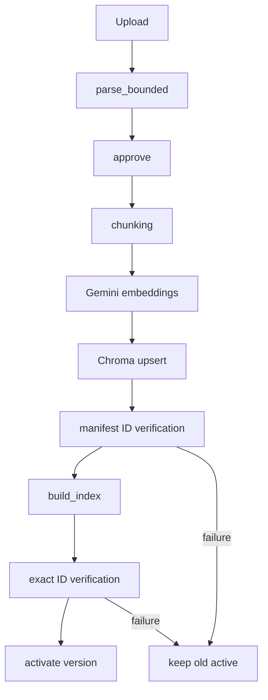
`app/services/ingestion.py:process` нь хоёр индекс баталгаажсаны дараа хувилбарыг идэвхжүүлдэг.

Sparse JSON artifact бүр `version_id` болон canonical chunk ID-г агуулна. `app/services/sparse.py:load_index` mtime fingerprint-ээр process cache хийж, `build_index` атомик бичилт хийнэ. Chunk текст PostgreSQL-д давхар хадгалагдахгүй. `backfill-sparse` CLI нь бэлэн Chroma бичлэгээс embedding хийхгүйгээр sparse artifact сэргээнэ.

## 2. Хайлт ба эрэмбэлэлт

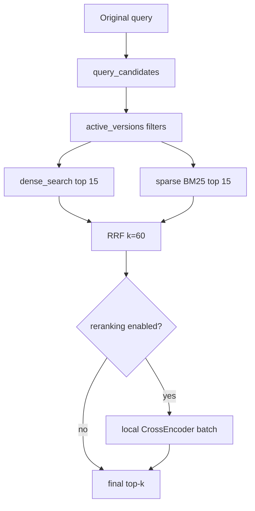
Код: `app/services/retrieval.py:retrieve`, `dense_search`; `app/services/sparse.py:search`, `rrf`.

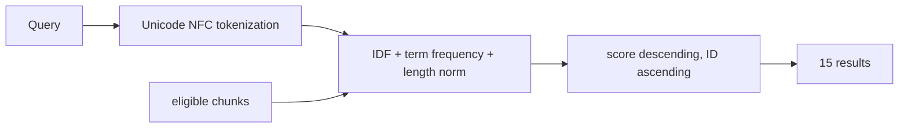
Sparse tokenizer кирилл болон латин үсгийн цувралыг хадгалж, Unicode-aware токен үүсгэнэ. Баримтын гарчиг, файлын нэр, байгаа section мэдээлэл chunk index-ийн текстэнд орно. Байгууллагын corpus дээр BM25 чанарыг үнэлэх шаардлагатай.

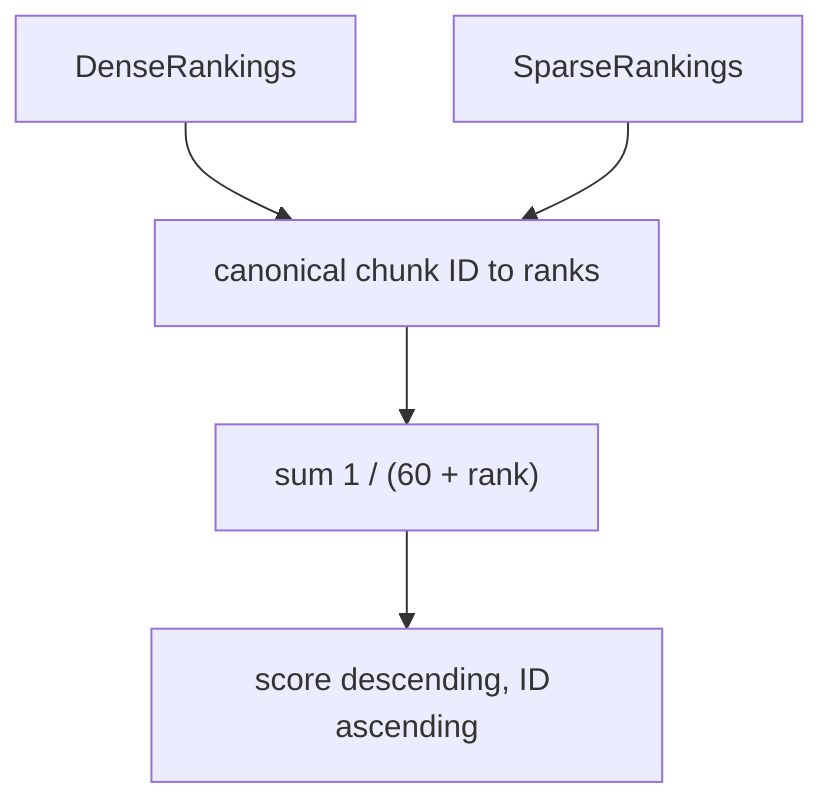
`sparse.rrf` ID-гаар давхардлыг нэгтгэнэ; хоосон branch хүчинтэй. Hybrid-д нэг active version-ийн sparse индекс дутуу эсвэл эвдэрсэн бол dense-only fallback хийнэ, `sparse_degraded` болон хувилбарын ID-г trace-д бүртгэнэ. Энэ нь hybrid acceptance-д амжилт гэж тооцогдохгүй.

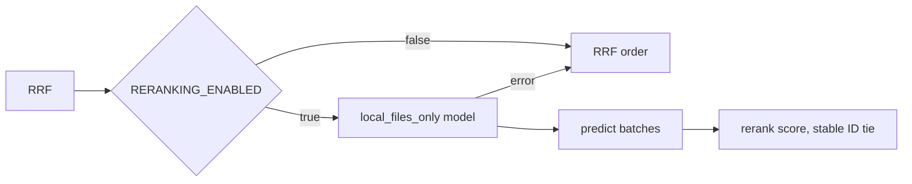
`_reranker()` model-ийг app process дотор нэг удаа cache хийнэ. `requirements-reranker.txt` optional; model weight татахгүй, local model path заана. Ачаалах болон scoring алдаа RRF дарааллыг үлдээнэ. Монгол хэлний benchmark нотолгоо одоогоор байхгүй.

## 3. Context, generation, telemetry

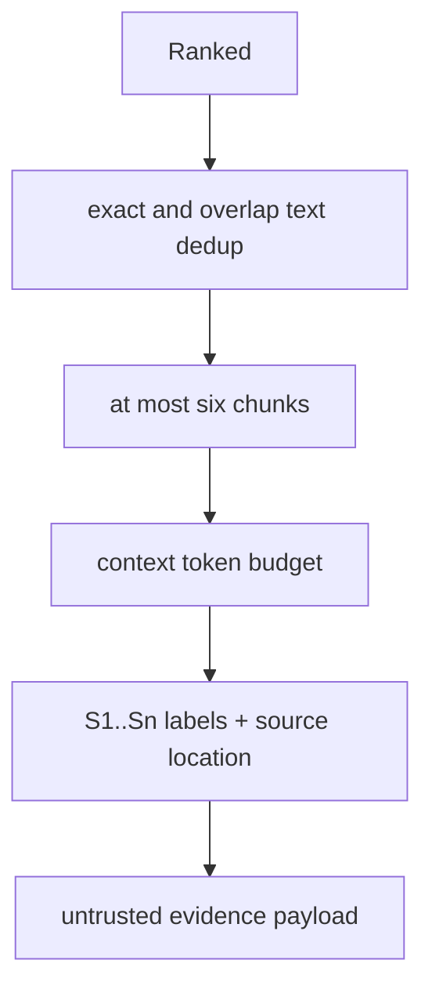
`app/services/rag.py:build_context` эх текст, title, version, metadata location, citation label-ийг хадгалж, түүх болон input token budget-ийг хянадаг.

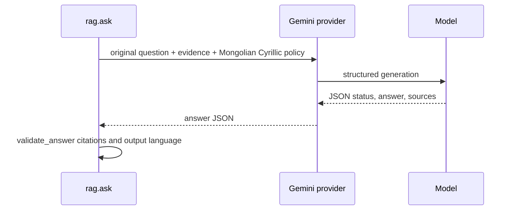
Код: `app/services/rag.py:SYSTEM`, `validate_answer`; `app/services/gemini.py:generate`.

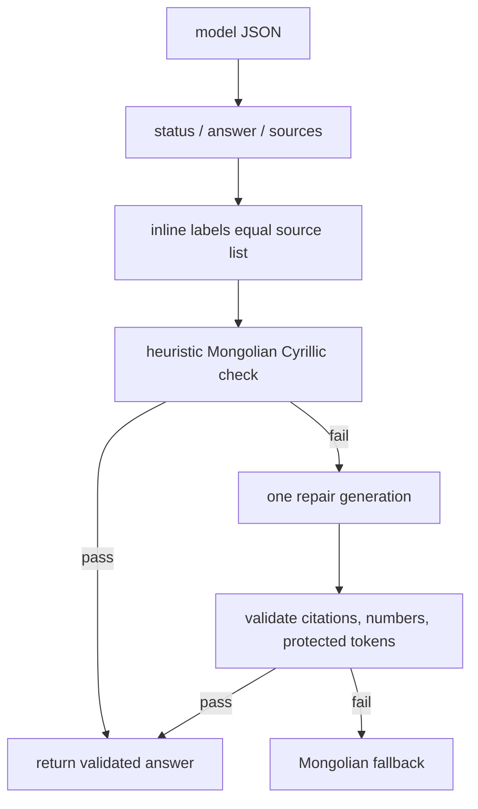
Нийт generation хүсэлт дээд тал нь хоёр: эх хариулт болон нэг citation/JSON retry эсвэл language repair. Засвар эх citation list, хамгаалсан тоо, acronym, URL, citation token-ийг өөрчилбөл татгалзана. Энэ шалгалт нь source faithfulness-ийг бүрэн батлахгүй.

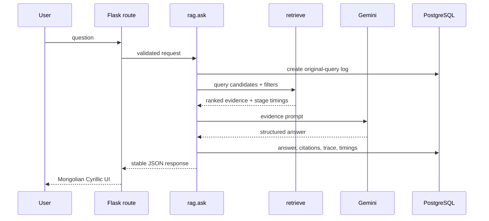
Одоогийн endpoint болон JSON key хадгалагдсан. Retrieval hit-д `distance` nullable; sparse/RRF score, branch ranks болон optional rerank score нэмэгдэнэ. UI null distance дээр алдаа гаргахгүй.

## 4. Хэл илрүүлэлт ба query хувилбар

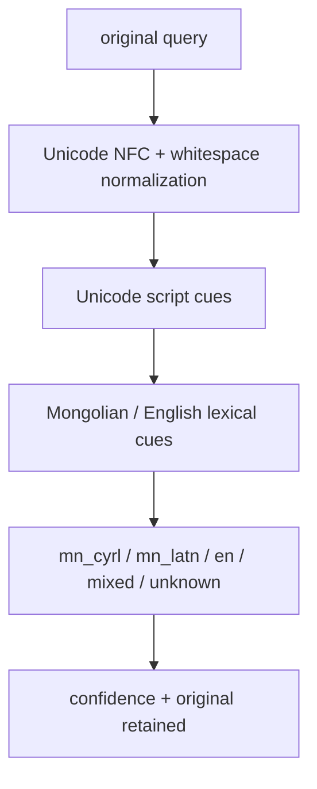
`app/services/language.py:detect_language` хэлийг heuristic-ээр ангилдаг. Query language нь document-language filter биш.

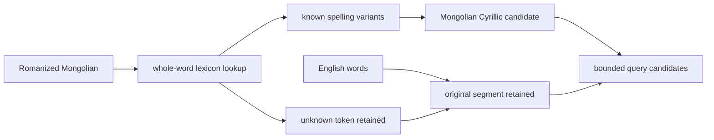
`normalize_latin_mongolian` хамгаалсан identifier болон танигдаагүй үгийг өөрчлөхгүй; бүх роман бичвэрийг автоматаар хөрвүүлэхгүй.

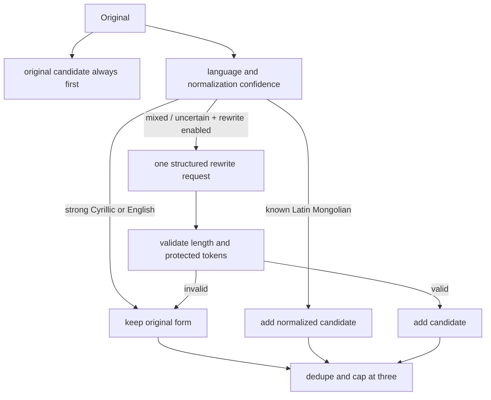
`query_candidates` болон `rag.ask` candidate limit-ийг барина. Query rewrite default off.

## 5. Бодит call graph ба үнэлгээ

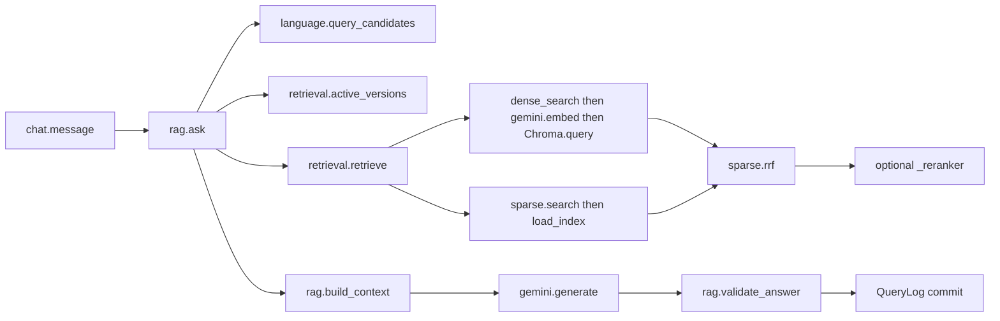
Энэ нь кодын бодит гол дуудлагын зам; `app/services` модуль дотор хадгалагдана.

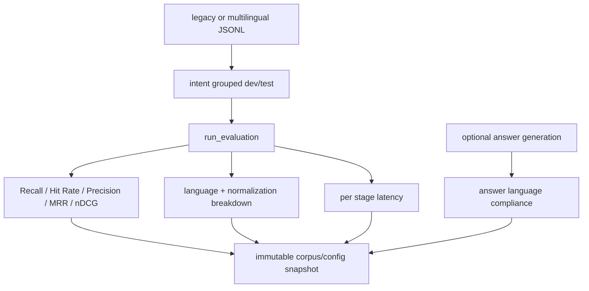
`app/evaluation.py:run_evaluation`, `metrics`, `compare_runs` нь legacy `mn`/`en` dataset уншина. Нэг intent-ийн хувилбарууд ижил split-д байна. Synthetic fixture нь зөвхөн хөгжүүлэлтэд; approved бодит баримт, reviewed evidence label байхгүй үед эцсийн чанарын acceptance pending.

## 6. Үйл ажиллагаа ба хязгаарлалт

Hybrid default. Буцаахын тулд `RETRIEVAL_MODE=dense`; индекст өөрчлөлт хийхгүйгээр query branch-ийг солино. Одоо байгаа бэлэн хувилбаруудын sparse artifact-ыг `python -m flask --app app backfill-sparse` командаар үүсгэнэ. Reconcile болон deletion sparse artifact-ыг хамруулдаг.

Монгол латин normalization нь хувилбарын толь ашигладаг хамгаалалттай candidate generation; бүх диалект, typo, romanization-ийг хамрахгүй. Англи асуултыг эх хувилбараар multilingual embedding-д өгнө. Query rewrite default off, зөвхөн mixed/unknown дээр нэг хүсэлт хийнэ. Хэл илрүүлэлт болон output checker heuristic тул хүний үнэлгээг орлохгүй. Corpus, reviewed label, бодит latency/quality benchmark-гүй тул чанарын босго батлагдаагүй.
