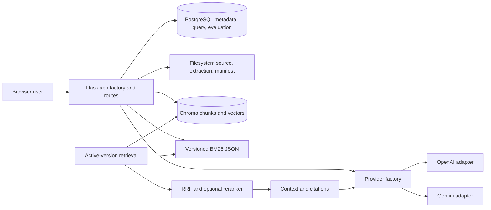
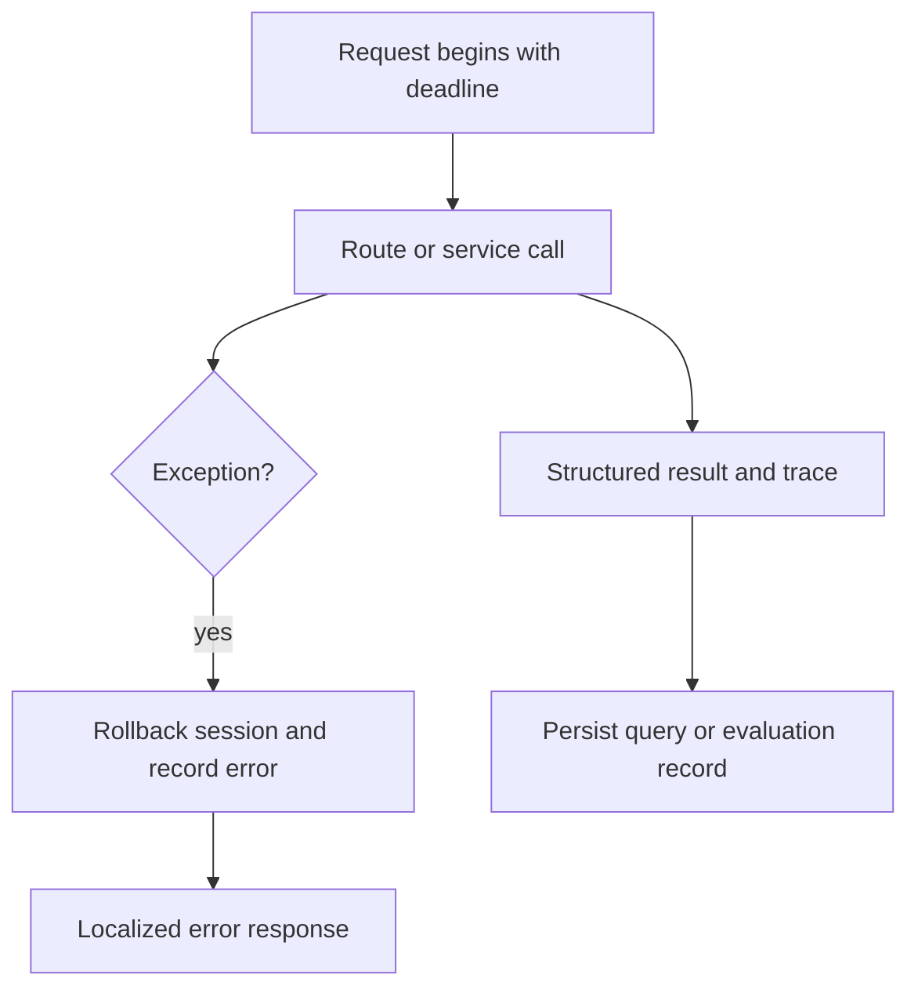
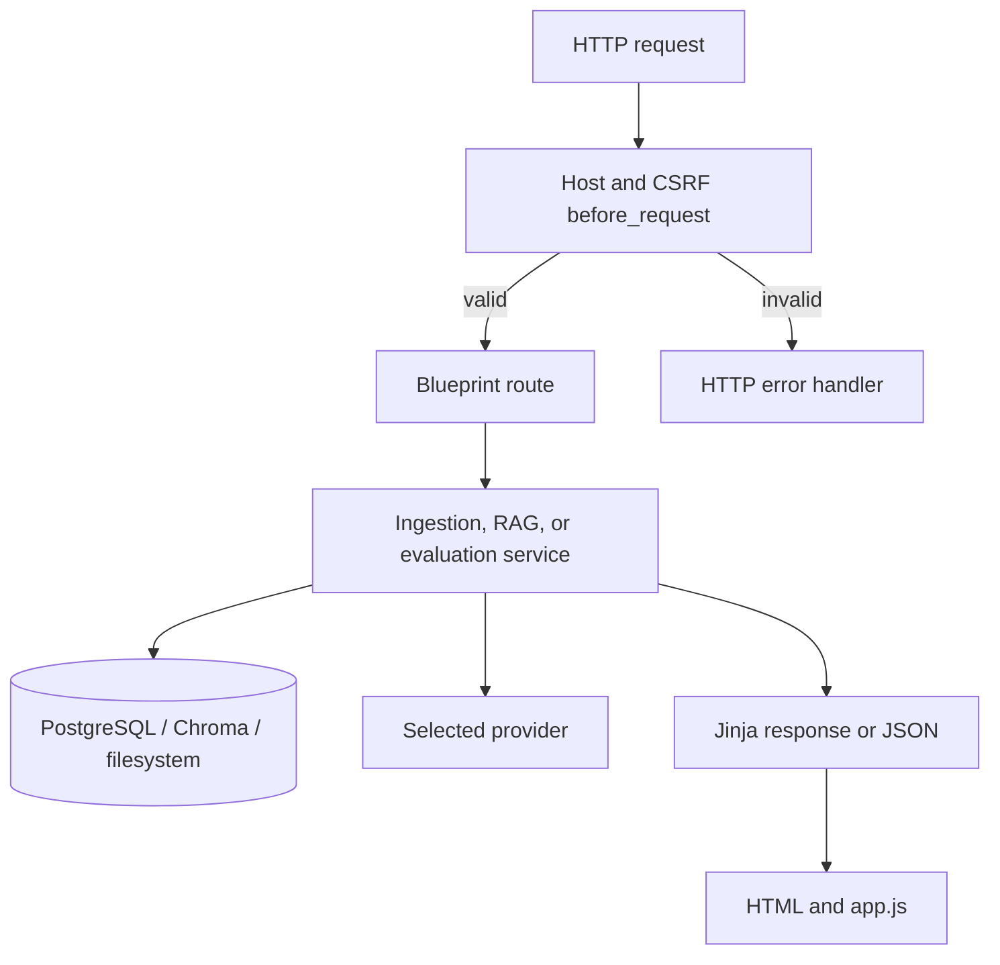
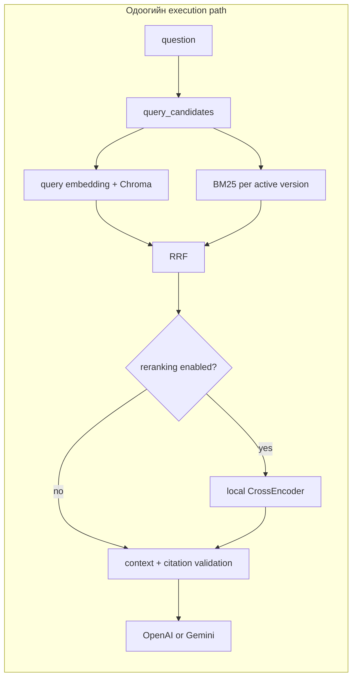

# 01 — Архитектурын аудит

## Бодит бүтэц

Flask app factory нь тохиргоо уншиж, SQLAlchemy/Migrate, route болон CLI-г бүртгэнэ. PostgreSQL нь баримтын metadata, version, query log, evaluation хадгалдаг; Chroma нь chunk текст/вектор хадгалдаг; filesystem нь эх файл, extraction болон manifest/artifact хадгална. Provider factory OpenAI эсвэл Gemini adapter сонгоно. Retrieval нь active version-уудаар шүүж dense болон sparse салбарыг ажиллуулж, RRF нэгтгэл, optional reranker, context/generation руу дамжуулдаг.

## Call graph ба ownership

Entrypoint: `app:create_app` → `app/routes/*` and `app/cli.py`. Upload/process route → `services/ingestion.py` → `parsing.py` / `chunking.py` / `providers.py` → `vectorstore.py` + `sparse.py` → PostgreSQL active pointer. Chat route → `services/rag.py:ask` → `language.query_candidates` → `retrieval.retrieve` → provider embedding + Chroma/BM25 → `sparse.rrf` → optional CrossEncoder → `build_context` → adapter generation → `validate_answer` → `QueryLog`. Evaluation reuses retrieval/chat services and stores snapshots/results through `evaluation.py`.

`storage.py` owns filesystem atomic writes and cross-process mutation lock. `index_migration.py` owns provider index prepare/activate/rollback. `cli.py` exposes doctor, process/reconcile, sparse backfill, migration and evaluation commands. This division is reasonably understandable, though `rag.py` still coordinates detection, retrieval, generation, validation, repair and query logging.

## Dependency болон ирээдүйн боломж

Import graph-аас `app` → `services` → `models/extensions` чиглэлийн ерөнхий урсгал харагдана; obvious circular import статик шалгалтаар нотлогдоогүй. Provider interface нь embedding/generation/rewrite/counting-ийг багтаадаг. OCR/parsing provenance болон metadata нь multimodal өргөтгөлийн эхлэл боловч зураг/аудио/видео ingestion, modality-aware chunk, multimodal embedding/search одоогоор хэрэгжсэн гэж үзэх нотолгоо алга. Иймд multimodal readiness-ийг **NOT IMPLEMENTED / not scored as broken** гэж ангилна.

**Архитектурын дүгнэлт:** нэг локал хэрэглэгчийн сургалтын хэрэгсэлд ойлгомжтой modular монолит. Хамтын үйлчилгээний scale/security boundary, worker queue болон shared vector service шийдээгүй.
