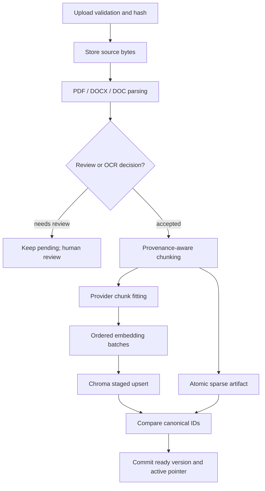
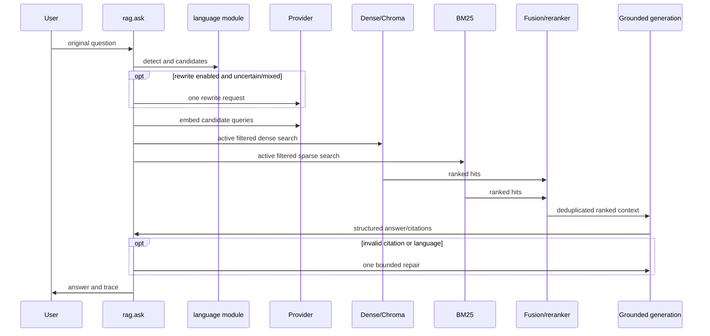

# 03 — RAG pipeline аудит

## Ingestion

Upload нь 20 MiB app cap, extension/type validation, content hash duplicate handling ашигладаг. Parsing нь PDF/DOCX/DOC-д native extraction, DOC conversion болон шаардлагатай үед OCR subprocess-ийг timeout/page limits-тэй ажиллуулна. Review-required extraction нь хүн батлахаас өмнө индексжихгүй. Chunker provenance metadata болон deterministic ID үүсгэж, provider `fit_chunks`/batch embedding хийдэг. Ingestion нь Chroma upsert, sparse artifact ID-г тулгаад version-ийг ready/active болгодог. Хоёр тусдаа storage-д atomic transaction байхгүй ч active pointer нь verify хийсний дараа шилждэг.

## Retrieval ба generation

`RETRIEVAL_MODE=hybrid` default; dense болон sparse branch тус бүр 15 candidate, `RRF_K=60`; dense-only rollback available. Query language label нь document-language filter болж автоматаар хэрэглэхгүй. Active-version/document filter хоёр branch-д хамт хэрэглэгдэнэ. Query candidate максимум гурван; optional rewrite нь mixed/unknown дээр нэг хүсэлт боловч provider exception fallback асуудалтай (**AUDIT-003**). RRF дараа optional local CrossEncoder batch score хийнэ; model path заасан, `local_files_only=True`; failure fused order-ийг хадгална.

Context selection removes exact/substring overlap, preserves canonical text and source labels, chooses up to six chunks within token budget. Citation labels are bounded to selected context and answer repair count is one. `still_active` is checked before/after generation to reduce stale citation races.

## Батлагдсан гол finding

- **AUDIT-003:** rewrite exception whole-request failure.
- **AUDIT-006:** sparse `load_index` schema/version/unique-ID шалгадаг боловч content fingerprint-ийг дахин бодож, canonical metadata/term integrity-г тулгадаггүй. Atomic write байдаг тул асуудал нь normal partial write биш, artifact corruption/tampering detection юм.
- Dense Chroma restart persistence test орчинд PASS; бүтэн PostgreSQL + Chroma activation/reconcile/backfill lifecycle энэ удаа NOT TESTED.

Chunk sizes and provider input budgets нь `config.py`, fingerprint generation болон provider adapter-аас шалтгаалдаг. Түргэн manual read нь бүх alternate provider/chunk boundary combinations-ийг runtime-ээр батлаагүй. Дэлгэрэнгүй config trace [11](11-configuration-and-dependencies-audit.md)-д.
