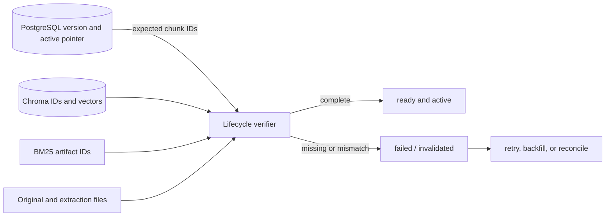

# 04 — PostgreSQL, Chroma ба cross-store integrity

## Өгөгдлийн эзэмшил

PostgreSQL owns documents, immutable document versions, active version pointers, query logs, evaluation runs/questions/results. `DocumentVersion` нь owner/document-тэй холбоотой composite constraint болон state check-тэй. Chroma collection fingerprint-аар тусгаарлагдаж canonical chunk IDs, текст, metadata, vectors хадгална. Filesystem source/extraction/chunk manifest болон per-version sparse JSON хадгална.

`ingestion.process` дараалал нь Chroma + sparse artifacts бэлтгэх → ID-г manifest-тай тулгах → DB-д ready болон active pointer commit. Delete эхлээд хайлтаас хасаж, дараа нь Chroma болон artifact-ийг retry хийх төлөвтэй цэвэрлэнэ. `reconcile` DB мэддэг хувилбарын vector/sparse зөрүү, orphan vectors-ийг шалгана. Migration prepare нь идэвхтэй хувилбарыг орлохгүй; activate олон pointer-ийг нэг DB transaction-аар сольж, rollback нь manifest ownership-ийг шалгана.

## Аюулгүй байдлын хязгаар

Database integration fixture setup/teardown бүр `db.drop_all()` ашигладаг бөгөөд database URL-ийн нэр зөвхөн `rag_test` prefix-ээр шалгагдана (`tests/conftest.py:43-63`). Prefix-тэй боловч disposable биш database-д өгөгдөл устгах боломжтой тул **AUDIT-001 HIGH**. Энэ audit одоо ажиллаж буй `postgresql-x64-16` service-ийг ашиглаагүй, DB-тэй холбогдоогүй. Тусгай хоосон audit database баталгаажаагүй учир integration suite ажиллуулах эрхгүй гэж үзсэн.

Cross-store distributed transaction байхгүй нь README-д ил тод. Ingestion active pointer-ийг verify-ийн дараа сольдог нь failure-д хуучин хувилбарыг хамгаалдаг. Гэсэн ч process interruption үед transient orphan artifacts үлдэж болох ба reconcile нь DB-гүй original source файл хайхгүй. Upload DB commit exception-ийн нөхцөлт файл orphan нь **AUDIT-009 LOW/LIKELY**.

Query history/citations хадгалалттай; эх файл устсан үед historical trace-д source unavailable байж болохыг баримтжуулсан. Query detail олон hit тус бүрт source/Chroma fetch хийдэг тул N+1 бол **AUDIT-010 LOW**.
