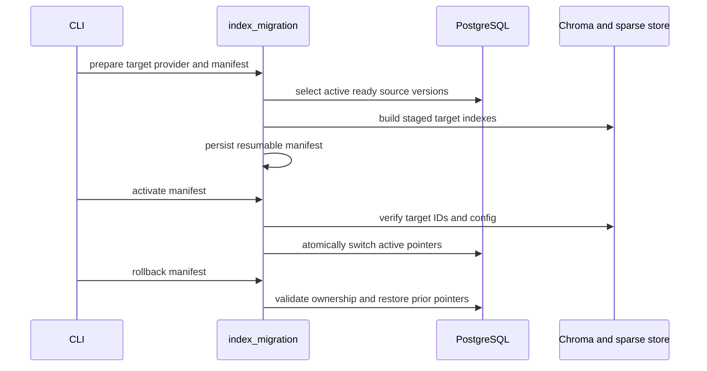

# 11 — Configuration ба dependency аудит

## Provider and retrieval configuration trace

`AI_PROVIDER` absent үед legacy Gemini generic `EMBEDDING_MODEL`/`GENERATION_MODEL`-г хэрэглэнэ. Explicit OpenAI selection provider-specific model/dimension ашиглана. OpenAI/Gemini key-ийг selected provider factory шаарддаг. Embedding space fingerprint нь provider/model/dimensions/chunk fitting revision агуулдаг гэж migration/index кодод туссан. Өөр embedding space-ийн active index-тэй query хийхэд explicit mismatch error өгнө.

| Flag / setting | Default | Хэрэглээ |
|---|---:|---|
| `AI_PROVIDER` | legacy `gemini` | provider factory, index fingerprint |
| `RETRIEVAL_MODE` | `hybrid` | dense-only эсвэл dense+BM25 retrieval |
| `DENSE_TOP_K` / `SPARSE_TOP_K` | 15 / 15 | branch candidate limits |
| `RRF_K` | 60 | rank fusion constant |
| `RERANKING_ENABLED` | false | local CrossEncoder path; path required |
| `RERANKER_MODEL_PATH` | empty | local-only model directory |
| `QUERY_REWRITING_ENABLED` | false | mixed/unknown дээр selected provider rewrite |
| `CONTEXT_CHUNKS` | 6 | context candidate cap |

```mermaid
flowchart TD
  Env[Environment and .env] --> Settings[settings(instance)]
  Settings --> Validate[validate selected provider and limits]
  Validate --> Factory[provider factory]
  Factory -->|openai| OA[OpenAI key/model/dimensions]
  Factory -->|gemini or legacy| GM[Gemini key/model/dimensions]
  Settings --> Index[embedding configuration fingerprint]
  Index --> Compatibility[active index compatibility check]
  Settings --> Retrieval[hybrid/dense, top-k, RRF]
  Settings --> Optional[reranking and rewrite flags default off]
```



## Dependency evidence

`requirements.txt` pins core runtime libraries, OpenAI, Google GenAI, Chroma, database, file parsing and pytest. `requirements.lock.txt` has Windows CPython 3.12 environment-specific package resolution. `requirements-reranker.txt` is separate optional `sentence-transformers` range. Installed environment reported 120 packages; `uv pip check` PASS. Import checks: `coverage`, `ruff`, `vulture`, `bandit`, `pip_audit`, and `sentence_transformers` unavailable. No package installed during audit.

Dependency advisory sweep has **NOT BEEN COMPLETED**. No claim that current pins are vulnerability-free. Registry records exact lock revisions for future official advisory matching; security section lists this as limitation. Lock portability limit documented in README.

## Snapshot and stale-documentation risk

README labels baseline defaults Gemini even though `.env.example` selects OpenAI; the table is titled “Baseline configuration,” which can be read as application default. Clarify effective application default versus example-file override. README's call ownership lines mention `gemini.py` owns generic remote calls although provider-neutral/OpenAI modules now exist; documentation drift is a low priority. Historical docs 01–09 were not edited per audit scope.
