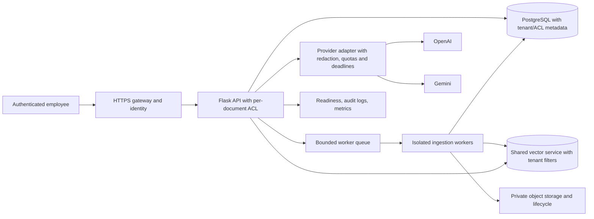

# 14 — Remediation roadmap

Энэ roadmap зөвхөн зөвлөмж. Аудитын явцад source code засварлаагүй.

## P1 — Safety/deployment gate

1. `tests/conftest.py` destructive DB guard-ийг fail-closed болго; dedicated disposable PostgreSQL-ийг тусгаарласан тэмдэглэгээ/unique name/isolated service-ээр батлах. Regression: shared DB URL дээр тест эхлэхээс өмнө abort; disposable target-д lifecycle suite ажиллах.
2. Хэрэв олон ажилтанд өгөх бол identity, role/document ACL, proxy/host/CSRF boundary-г загварчилж хэрэгжүүлэх. Regression: хоёр хэрэглэгчийн document visibility, upload, history тусгаарлагдсан.

## P2 — Correctness болон найдвартай байдал

3. Rewrite failure-ийг degraded trace болгон original candidate-уудаар үргэлжлүүлэх. Dependency: provider contract. Regression: timeout/quota exception-аар chat error биш retrieval үргэлжилнэ; maximum нэг rewrite хэвээр.
4. nDCG observed/ideal gain-ийг нэг томьёонд нийцүүлэх. Regression: нэг result олон gold unit match хийхэд score [0,1] дотор.
5. Sparse artifact fingerprint/manifest/metadata consistency-г load/reconcile-д шалгаж, invalid artifact-ийг rebuild/degrade төлөвт шилжүүлэх. Regression: altered terms/text/hash бүхий artifact active evidence болохгүй.
6. Mongolian answer validator-д Cyrillic non-Mongolian adversarial examples ба protected identifiers-тэй human-reviewed test corpus нэмэх. Regression: Russian Cyrillic fail, Mongolian prose pass, source titles/codes хадгалагдана.
7. Query/evaluation history pagination болон document picker-г нэмэх. Regression: deterministic ordering, page state/back navigation, mobile labels.
8. Liveness ба dependency readiness-г тусад нь үзүүлэх. Regression: database outage readiness-д fail, liveness process-alive хэвээр.

## P3 — Storage/performance polish

9. DB commit failure-ийн үед upload source rollback/cleanup эсвэл orphan scanner нэмэх. Regression: injected commit failure-ээр unattached source файл үлдэхгүй/илэрдэг.
10. Query detail trace hit/source/chunk retrieval-ийг batch болгох. Regression: N hit-д DB/Chroma call count өсөхгүй.

## Audit-аар дуусаагүй баталгаа

Dedicated isolated PostgreSQL + temporary Chroma дээр integration test; browser visual review; live provider availability (зөвхөн тусдаа зөвшөөрөгдсөн төсөв/ключтэй үед); reviewed real corpus evaluation; official advisory mapping хэрэгтэй. Эдгээр нь энэ audit-д хийгдээгүй бөгөөд одоогийн тайлан тэдгээрийг PASS гэж тооцохгүй.

## Одоогийн биш, санал болгож буй shared architecture

Энэ диаграм нь санал болгож буй чиглэл; одоогийн implementation биш.
